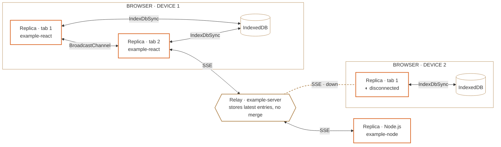
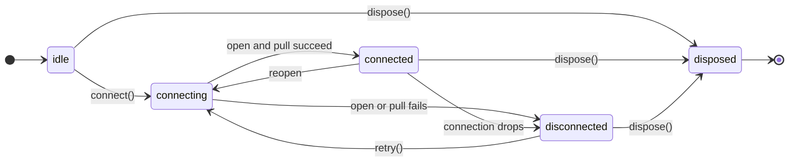

<!-- cspell:words goodstate -->

# Diagrams

Mermaid diagrams for READMEs and docs. Colors and type follow [`VISUAL_GUIDELINES.md`](VISUAL_GUIDELINES.md).

## Rules

- A replica runs a store and merges. Browser, Node.js, and API-route replicas are peers, so they all get the same shape.
- A relay forwards entries and never merges. `example-server` is a relay. Draw it with the hexagon shape (`{{ }}`), never as a replica.
- Persistence (IndexedDB, memory, Redis) is a cylinder (`[( )]`).
- Group replicas by environment in a `subgraph` labeled `BROWSER · DEVICE 1`.
- Label every link with its transport: `SSE`, `BroadcastChannel`, `IndexDbSync`.
- Draw offline on the link, not the node. A disconnected replica keeps its normal outline, and its link turns dashed. The link is down, the state is intact.
- Status words are `SyncState` values (`connected`, `disconnected`), with the glyph from the guide.
- Mars Orange on at most one kind of focal element.

## Mermaid for GitHub

Only strokes are styled. Fills stay transparent and text inherits GitHub's own theme, so the diagram reads in light and dark mode. Mars Orange `#D9621E` and Bronze `#B48A55` both keep at least 3:1 against GitHub's light (`#FFFFFF`) and dark (`#0D1117`) canvases. Don't depend on init directives or `themeVariables` in a README, since GitHub's renderer changes.



`linkStyle 5` targets the sixth link, counted from zero in source order. Update the index whenever you add or reorder links.

## Mermaid on a site you control

Render with the `base` theme and pass the tokens as `themeVariables`. Re-render diagrams when the theme changes, because Mermaid bakes colors into the SVG.

```js
const light = {
	background: "#FAF0DE",
	primaryColor: "#FFFAF0",
	primaryTextColor: "#1C130C",
	primaryBorderColor: "#1C130C",
	secondaryColor: "#EEDDC2",
	tertiaryColor: "#FAF0DE",
	lineColor: "#1C130C",
	clusterBkg: "#FAF0DE",
	clusterBorder: "#6B4A34",
	edgeLabelBackground: "#FAF0DE",
	fontFamily: "IBM Plex Sans, system-ui, sans-serif",
	fontSize: "14px",
};

const dark = {
	...light,
	background: "#1C130C",
	primaryColor: "#241810",
	primaryTextColor: "#FAF0DE",
	primaryBorderColor: "#B48A55",
	secondaryColor: "#140D08",
	tertiaryColor: "#1C130C",
	lineColor: "#FAF0DEB3",
	clusterBkg: "#1C130C",
	clusterBorder: "#B48A55",
	edgeLabelBackground: "#1C130C",
};

mermaid.initialize({
	startOnLoad: false,
	theme: "base",
	themeVariables: document.documentElement.dataset.theme === "dark" ? dark : light,
	flowchart: { curve: "linear" },
});
```

## Sync engine lifecycle

A state diagram that uses the real `SyncState` values from `@goodstate/sync-engine`. Keep it in plain Mermaid so it renders the same everywhere.



`connecting` can also move to `disposed`. It is left out to keep the diagram readable, which is the kind of simplification to call out in prose.
