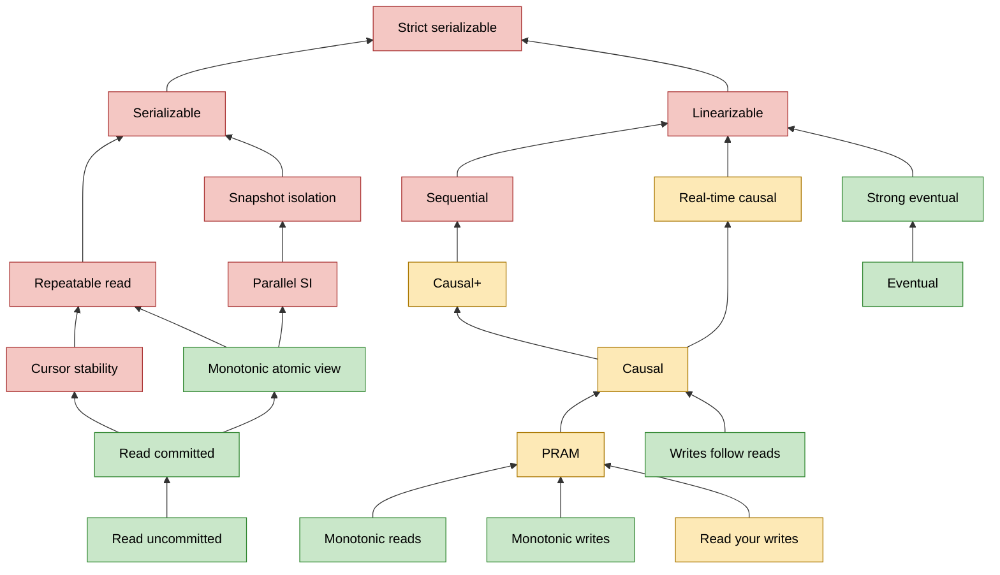

# Consistency models in distributed systems: what each one forbids, which survive a partition, and where `@goodstate/store` sits

Researched **2026-11-18** (some fetches ran past midnight into 2026-11-19). Every definition below was read in the paper or document that owns it. Where the only reachable copy was a course or university mirror of the published text, the table says so. Mirrors are reproductions, not secondary sources. Secondary sources are flagged where they are used.

**Papers** (full text read unless noted; section and page numbers are those of the copy read):

| Topic                    | Source                                                                                                                                             | Copy read                                                                            |
| ------------------------ | -------------------------------------------------------------------------------------------------------------------------------------------------- | ------------------------------------------------------------------------------------ |
| Sequential consistency   | Lamport, IEEE Trans. Computers C-28(9):690–691, 1979, doi:10.1109/TC.1979.1675439                                                                  | [author scan][lamport79]                                                             |
| Linearizability          | Herlihy & Wing, ACM TOPLAS 12(3):463–492, 1990, doi:10.1145/78969.78972                                                                            | [ACM-typeset copy on author site][hw90]                                              |
| Serializability, SSR     | Papadimitriou, JACM 26(4):631–653, 1979, doi:10.1145/322154.322158                                                                                 | [course-hosted journal scan][papa79] (ACM DL returned HTML only)                     |
| External consistency     | Corbett et al., "Spanner", OSDI 2012, pp. 251–264                                                                                                  | [USENIX][spanner12]                                                                  |
| ANSI critique, SI        | Berenson, Bernstein, Gray, Melton, O'Neil, O'Neil, SIGMOD 1995, doi:10.1145/223784.223785                                                          | [MSR-TR-95-51][berenson95] (TR page numbers)                                         |
| Generalized isolation    | Adya, PhD thesis, MIT, 1999 (MIT/LCS/TR-786)                                                                                                       | [MIT LCS TR][adya99] (pmg.csail.mit.edu refused connections)                         |
| Parallel SI              | Sovran, Power, Aguilera, Li, "Transactional storage for geo-replicated systems", SOSP 2011, doi:10.1145/2043556.2043592                            | [course-hosted ACM copy][walter11]                                                   |
| SI anomalies             | Fekete et al., "Making Snapshot Isolation Serializable", TODS 30(2), 2005, doi:10.1145/1071610.1071615                                             | [course-hosted ACM copy][fekete05]                                                   |
| Atomic visibility models | Cerone, Bernardi, Gotsman, CONCUR 2015, doi:10.4230/LIPIcs.CONCUR.2015.58                                                                          | [LIPIcs][cerone15]                                                                   |
| Session guarantees       | Terry, Demers, Petersen, Spreitzer, Theimer, Welch, PDIS 1994, pp. 140–149, doi:10.1109/PDIS.1994.331722                                           | [course mirror][terry94]                                                             |
| Causal memory            | Ahamad, Neiger, Burns, Kohli, Hutto, Distributed Computing 9(1):37–49, 1995, doi:10.1007/BF01784241                                                | [Georgia Tech TR GIT-CC-93/55, rev. 1994][ahamad95] (OCR; not the journal version)   |
| PRAM                     | Lipton & Sandberg, Princeton CS-TR-180-88, 1988                                                                                                    | [Princeton FTP scan][lipton88] (OCR)                                                 |
| Causal+ (COPS)           | Lloyd, Freedman, Kaminsky, Andersen, SOSP 2011, doi:10.1145/2043556.2043593                                                                        | [author preprint][cops11]                                                            |
| CAC theorem              | Mahajan, Alvisi, Dahlin, "Consistency, Availability, and Convergence", UTCS TR-11-22, 2011                                                         | [author site][cac11]                                                                 |
| Eventual consistency     | Vogels, "Eventually Consistent", ACM Queue 6(6), 2008; CACM 52(1), 2009                                                                            | [author's revised post, 2008-12-23][vogels08] (ACM copies blocked; see §7)           |
| CRDTs, SEC               | Shapiro, Preguiça, Baquero, Zawirski, SSS 2011, LNCS 6976, doi:10.1007/978-3-642-24550-3_29; INRIA RR-7687 (2011) and RR-7506 (2011)               | [SSS mirror][crdt-sss], [RR-7687 mirror][crdt-rr7687], [RR-7506 mirror][crdt-rr7506] |
| Replicated data types    | Burckhardt, Gotsman, Yang, Zawirski, POPL 2014, doi:10.1145/2535838.2535848; Burckhardt, _Principles of Eventual Consistency_, FnT PL 1(1–2), 2014 | [MSR extended version][burckhardt14], [MSR][poec14]                                  |
| SEC verified             | Gomes, Kleppmann, Mulligan, Beresford, PACMPL 1(OOPSLA), 2017, doi:10.1145/3133933                                                                 | [arXiv 1707.01747v3][gomes17]                                                        |
| CAP proof                | Gilbert & Lynch, SIGACT News 33(2):51–59, 2002, doi:10.1145/564585.564601                                                                          | [MIT PostScript `Brewer6.ps`][gl02] (an earlier NUS draft differs in §4.4; see §7)   |
| CAP revisited            | Brewer, IEEE Computer 45(2):23–29, 2012, doi:10.1109/MC.2012.37                                                                                    | [course-hosted publisher PDF][brewer12]                                              |
| PACELC                   | Abadi, IEEE Computer 45(2):37–42, 2012, doi:10.1109/MC.2012.33                                                                                     | [author site][abadi12]                                                               |
| HATs                     | Bailis, Davidson, Fekete, Ghodsi, Hellerstein, Stoica, PVLDB 7(3):181–192, 2013, doi:10.14778/2732232.2732237                                      | [VLDB][hat13]                                                                        |
| OCC bound                | Attiya, Ellen, Morrison, PODC 2015, pp. 385–394, doi:10.1145/2767386.2767419                                                                       | [authors' version][aem15]                                                            |
| Taxonomy                 | Viotti & Vukolić, ACM Computing Surveys 49(1), 2016, doi:10.1145/2926965                                                                           | [arXiv 1512.00168v4][vv16] (arXiv page numbers)                                      |
| CAP critique             | Kleppmann, arXiv:1509.05393v2, 2015 (not peer-reviewed)                                                                                            | [arXiv][kleppmann15]                                                                 |
| Registers                | Lamport, "On Interprocess Communication", Distributed Computing 1(2), 1986                                                                         | [SRC Research Report 8][lamport86]                                                   |

**Jepsen**, first-party for Jepsen's own definitions and availability classes only: the [models page and map][jepsen-models] and its model subpages, fetched 2026-11-18. The page shows no last-updated date.

**Vendor documentation**, fetched 2026-11-18 unless a commit is given: Azure Cosmos DB ([consistency levels][cosmos], page `updated_at` 2026-04-27; history in [MicrosoftDocs/azure-docs][cosmos-change]; TLA+ specs at [`tlaplus/azure-cosmos-tla@2cfd1c3`][cosmos-tla] and [`Azure/azure-cosmos-tla@a8357c9`][cosmos-tla-old]); Amazon DynamoDB ([read consistency][ddb-read], [global tables][ddb-global], [transactions][ddb-tx]); Apache Cassandra 5.0 docs ([Dynamo][cass-dynamo], [guarantees][cass-guarantees]) and trunk at `53c3561e`; Google Cloud Spanner ([TrueTime and external consistency][spanner-tt], [transactions][spanner-tx]); MongoDB ([causal consistency][mongo-causal], [read isolation][mongo-ric]); CockroachDB ([transaction layer][crdb-tx]); PowerSync ([consistency][ps-consistency], [prioritized sync][ps-priority]); Replicache ([consistency][rep-consistency], [how it works][rep-hiw], [push][rep-push]); Zero ([queries][zero-queries], [mutators][zero-mutators]); ElectricSQL (`website/docs` at [`3f9809f`][electric-docs]).

**This repository** at `79bcd03` (2026-11-18), including the untracked `packages/store/src/query/`. Package versions: `@goodstate/store` 4.0.1, `@goodstate/entities` 4.2.1, `@goodstate/time` 1.1.2, `@goodstate/sync-engine` 5.0.0.

Companions in this directory: [Hybrid Logical Clocks](hybrid-logical-clocks.md) (the clock and its missing receive rule), [CRDT deltas](crdt-deltas.md) (causal delta-merging, version vectors), [Array-like CRDTs](array-like-crdts.md) (why ordering needs causality-compatible IDs), [Persisting CRDT metadata](crdt-metadata-persistence.md) (multi-tab lost writes), [Local-first web architecture](local-first-architecture.md) (authority models, multi-tab coordination) and [Local-first software](local-first-software.md). This note does not repeat them; it covers the guarantees.

---

## Short answer

**The hierarchy.** For single objects without transactions, from strongest to weakest: linearizability, sequential consistency, causal+ (and, incomparable with it, real-time causal), causal, PRAM, and the four session guarantees: read-your-writes, monotonic reads, monotonic writes and writes-follow-reads. Eventual consistency sits at the bottom, and strong eventual consistency adds one rule to it. Transactions have their own ladder: strict serializability, serializability, snapshot isolation and repeatable read (incomparable with each other), parallel snapshot isolation, monotonic atomic view, read committed and read uncommitted. Strict serializability is exactly serializability plus linearizability's real-time order; Herlihy & Wing call linearizability its single-operation, single-object special case. [HW90 §3.3, p. 473][hw90] [Viotti & Vukolić Fig. 1][vv16] [HAT Fig. 2][hat13]

**What each forbids, in one line:**

| Model               | Forbids                                                                           |
| ------------------- | --------------------------------------------------------------------------------- |
| Linearizable        | reading an old value after a write has returned (real time)                       |
| Sequential          | two observers disagreeing on the order of writes                                  |
| Causal+             | causal violations, and replicas that saw the same writes holding different values |
| Causal              | seeing an effect without its cause                                                |
| PRAM                | seeing one process's writes out of order                                          |
| Read-your-writes    | a session not seeing its own write                                                |
| Monotonic reads     | a session seeing a write and later not seeing it                                  |
| Monotonic writes    | a session's later write ordered or propagated before its earlier one              |
| Writes-follow-reads | a session's write ordered before a write it had already read                      |
| Strong eventual     | replicas that delivered the same updates being in different states                |
| Eventual            | a write never becoming visible                                                    |

**The availability boundary.** Gilbert & Lynch proved that no read/write object can be both linearizable and available in an asynchronous network that loses messages. [G&L §3.1, Thm 1][gl02] Bailis et al. sort the rest into three classes. **Highly available**: read uncommitted, read committed, monotonic atomic view, monotonic reads, monotonic writes, writes-follow-reads. **Sticky available**, meaning available only to a client that keeps talking to a replica holding its own prior operations: read-your-writes, PRAM, causal. **Unavailable**: anything that prevents lost update or write skew (snapshot isolation, repeatable read, serializability) or needs recency (linearizability). [HAT Table 3, p. 188][hat13] Jepsen adds sequential consistency to the unavailable set. [Jepsen map][jepsen-models] Mahajan et al. proved the ceiling: nothing stronger than real-time causal consistency is achievable in an always-available, one-way convergent system. [CAC Thm 3.1][cac11] A last-writer-wins store reaches causal+ rather than RTC. [COPS §7][cops11]

**For local-first this boundary is the design space.** A local-first client _is_ its own replica, so every sticky-available model is reachable as long as one session stays on one replica. The ceiling for a last-writer-wins CRDT store is **causal+**. Strong eventual consistency is the floor that CRDTs give for free.

**Where `@goodstate/store` sits today** (§6): replicas converge on register values and on which rows exist, which is strong eventual consistency for those, **provided** every replica's state eventually reaches every other. That proviso is weaker than it looks, because the example server replaces instead of merging. Row **order** does not converge, so lists are not SEC. Each tab is its own replica and session. Within a tab you get read-your-writes and monotonic reads. You do **not** get writes-follow-reads, because the clock has no receive rule, so a write made after reading a remote value can lose to that value. Without writes-follow-reads the store is neither causal nor causal+. A `mutate` that touches two top-level fields is pushed as two separate messages, so other replicas can see half of it. Across tabs and across reloads there are no session guarantees at all.

**What it would take to reach causal+:** an HLC receive rule; shipping a commit's changed roots, plus the roots they depend on, as one unit; a server that joins instead of replacing; the deferred ordering CRDT; and one replica per browser profile (or a session token) if tabs should share a session. Anything stronger, such as uniqueness, invariants or linearizable reads, needs a coordinating authority. Those operations then stop working offline.

---

## 1. Vocabulary: histories, visibility, arbitration, and what "available" means

**Histories.** Every definition below is a predicate on a _history_: the operations each process issued, with invocation and response times and return values. Herlihy & Wing write it as events; Viotti & Vukolić and Burckhardt et al. add two relations an implementation must exhibit:

- **Visibility `vis`**: which writes an operation has seen. "vis (visibility) is an acyclic natural relation that accounts for the propagation of write operations."
- **Arbitration `ar`**: "a total order on operations of the history that specifies how the system resolves conflicts."

[Viotti & Vukolić §2.3][vv16] [Burckhardt et al. §3.1, Def. 2][burckhardt14]

Other relations are derived:

- **Returns-before `rb`**: `a` finished before `b` started. This is real time.
- **Session order `so`**: `rb` restricted to one session.
- **Happens-before `hb ≜ (so ∪ vis)+`**. [Viotti & Vukolić Eq. 2][vv16]

Most models then read as "this relation must contain that one". Linearizability's `REALTIME` is `rb ⊆ ar` (Eq. 9). Causal visibility is `hb ⊆ vis`. That uniform shape is what makes the hierarchy in §3 checkable.

**Notation for the examples.** `w(x)1` writes 1 to `x`, `r(x)1` reads 1, and `x` starts at 0. Each line is one process or session, and time runs left to right.

**"Available" has three meanings, and they matter:**

- **Gilbert & Lynch**: "every request received by a non-failing node in the system must result in a response." [G&L §2.2][gl02]
- **Bailis et al.** call that high availability and add **sticky availability**: "whenever a client's transactions is executed against a copy of database state that reflects all of the client's prior operations, it eventually receives a response, even in the presence of indefinitely long partitions." [HAT §4.1, p. 184][hat13] ("transactions is" is verbatim.)
- **Jepsen**: "Total Available: Available on every non-faulty node, even when the network is completely down." "Sticky Available: Available on every non-faulty node, so long as clients only talk to the same servers, instead of switching to new ones." [Jepsen map legend][jepsen-models]

Kleppmann points out that Gilbert & Lynch's availability is stricter than Fox and Brewer's original "some replica is reachable". It is also a pure liveness property: a response "within some unbounded but finite time". [Kleppmann §2.1][kleppmann15] Brewer himself later wrote that "the '2 of 3' formulation was always misleading" and that "CAP prohibits only a tiny part of the design space: perfect availability and consistency in the presence of partitions". [Brewer 2012, p. 23][brewer12] Abadi's PACELC adds the trade-off that applies with no partition: "else (E), when the system is running normally in the absence of partitions, how does the system trade off latency (L) and consistency (C)?" [Abadi 2012, p. 41][abadi12]

---

## 2. Definitions, each with a history it allows or forbids

### 2.1 Linearizability (and the weaker registers)

> "A history H is linearizable if it can be extended (by appending zero or more response events) to some history H' such that: L1: complete(H') is equivalent to some legal sequential history S, and L2: <H ⊆ <S." [HW90 §2.2, pp. 468–469][hw90]

`<H` "captures the 'real-time' precedence ordering of operations". The abstract puts it informally: each operation "takes effect instantaneously at some point between its invocation and its response". Linearizability is **local**: "H is linearizable if and only if, for each object x, H|x is linearizable" (Theorem 1, §3.1, p. 470). Herlihy & Wing contrast this with sequential consistency and serializability, neither of which is local. [HW90 p. 464, §3.3][hw90]

Viotti & Vukolić: `LINEARIZABILITY(F) ≜ SINGLEORDER ∧ REALTIME ∧ RVAL(F)` (Eq. 7). [Viotti & Vukolić §3.1][vv16]

Lamport's 1986 register ladder sits below it. A **safe** register guarantees only that "a read not concurrent with any write obtains the correct value". A **regular** register adds that "a read that overlaps a write obtains either the old or new value". An **atomic** register behaves "as if they occur in some definite order". [Lamport 1986, Part II §4, pp. 19–20][lamport86]

```text
P1: w(x)1 |──returns──|
P2:                       r(x)0        ← forbidden: the read began after w(x)1 returned
```

### 2.2 Sequential consistency

> "the result of any execution is the same as if the operations of all the processors were executed in some sequential order, and the operations of each individual processor appear in this sequence in the order specified by its program." [Lamport 1979, p. 690][lamport79]

There is no real-time requirement. Herlihy & Wing: "Sequential consistency is weaker than linearizability, because it does not require the original history's precedence ordering to be preserved." [HW90 §3.3, p. 472][hw90] The history above is sequentially consistent, via the order `r(x)0, w(x)1`.

```text
P1: w(x)1
P2: w(x)2
P3:          r(x)1  r(x)2
P4:          r(x)2  r(x)1      ← forbidden: P3 and P4 disagree on the order of the two writes
```

### 2.3 Causal, causal+, real-time causal, observable causal

**Causal memory.** Ahamad et al. build a causality order from program order plus a _writes-into_ order that links each read to the write it returned, and take the transitive closure. "A history H is causal if it has a causality order ⇝ such that CM: for each process p_i, there is a serialization S_i of A_{H+i w} that respects ⇝." [Ahamad et al. TR §4, pp. 4–5][ahamad95] Each process may see concurrent writes in its own order, so the P3/P4 history above **is** causal.

Burckhardt and Viotti & Vukolić split causality into two axioms: **CausalVisibility** `hb ⊆ vis`, so you see everything that happened before what you see, and **CausalArbitration** `hb ⊆ ar`, so conflict resolution never puts an effect before its cause. [Viotti & Vukolić §3.5, Eq. 26][vv16] [Burckhardt, _Principles_ Fig. 5.1][poec14] The second axiom is the one `@goodstate` breaks (§6.4).

```text
P1: w(x)1
P2:        r(x)1  w(y)1
P3:                      r(y)1  r(x)0     ← forbidden: w(x)1 ⇝ w(y)1, so seeing y=1 means seeing x=1
```

**Causal+** = causal + _convergent conflict handling_: "all conflicting puts be handled in the same manner at all replicas, using a handler function h. This handler function h must be associative and commutative". COPS uses last-writer-wins by default. [COPS §3.1][cops11] Viotti & Vukolić write it as `CAUSALITY ∧ STRONGCONVERGENCE` (Eq. 27). COPS's abstract calls causal+ "the strongest achieved under these constraints" (ALPS: availability, low latency, partition tolerance, scalability). That is an argument, not a proof. In §7, COPS defers to Mahajan et al.

**Real-time causal (RTC)** adds "CC3 Time doesn't travel backward. For any operations u, v: u.endTime < v.startTime ⇒ v ⊀_G u." **Theorem 3.1**: "No consistency semantics stronger than real time causal consistency can be implemented using a one-way convergent and always available distributed storage implementation." Theorem 3.5 shows RTC is achievable, so the bound is tight. [CAC §2.1, §3][cac11]

The theorem's conditions matter:

- It assumes reads may return all concurrent writes. COPS: "COPS's efficient last-writer-wins rule results in a causal+ but not RTC consistent system". [COPS §7][cops11]
- It needs one-way convergence. "RTC is not the strongest always-available consistency semantics under two-way convergence". [CAC §5][cac11]

**Observable causal consistency (OCC).** For stores of multi-value registers with invisible reads and op-driven messages, "an eventually consistent data store implementing MVRs cannot satisfy a consistency model strictly stronger than observable causal consistency (OCC)". Such stores must also send messages of `min{n−2, s−1} lg k` bits. [Attiya, Ellen, Morrison, abstract and Thm 12][aem15] This is scoped to MVRs, so it does not bind an LWW store such as `@goodstate`'s.

**RTC and causal+ are incomparable.** COPS places RTC above causal+. Viotti & Vukolić disagree: "although [Lloyd et al., 2011] classifies real-time causal consistency as stronger than causal+ consistency, they are actually incomparable, as real-time causality — as defined in [Mahajan et al., 2011] — does not imply strong convergence." [Viotti & Vukolić §3.5, pp. 15–16][vv16] This note follows Viotti & Vukolić.

### 2.4 PRAM

Lipton & Sandberg define PRAM operationally. A write updates local memory and "sends a message <i,v> to all the other processors", and "a processor never waits for the completion of a global action". [Lipton & Sandberg §3, p. 4][lipton88] The ordering rule people quote is **not** stated there. It comes from later formalizations: "This memory requires only that the writes of each process be seen in program order at all other processes" [Ahamad et al. TR §3][ahamad95], and `PRAM ≜ so ⊆ vis` (Eq. 20) in Viotti & Vukolić.

The causal example in §2.3 is PRAM-legal, because P1's and P2's writes come from different processes. Viotti & Vukolić, citing Brzezinski et al. (secondary here): "PRAM consistency is ensured iff the system provides read-your-write, monotonic reads and monotonic writes." [Viotti & Vukolić §3.3][vv16] Add writes-follow-reads and you have causal consistency, which "requires and includes them all" (§3.4).

### 2.5 Session guarantees

Terry et al. define a session as "an abstraction for the sequence of read and write operations performed during the execution of an application". It is explicitly not a transaction. `DB(S,t)` is "the ordered sequence of Writes that have been received by server S at or before time t". [Terry et al. §1–2][terry94]

| Guarantee           | Terry et al. 1994 (§3)                                                                                                                                                                                                | Viotti & Vukolić (§3.4)       |
| ------------------- | --------------------------------------------------------------------------------------------------------------------------------------------------------------------------------------------------------------------- | ----------------------------- |
| Read Your Writes    | "If Read R follows Write W in a session and R is performed at server S at time t, then W is included in DB(S,t)."                                                                                                     | `so\|wr→rd ⊆ vis` (23)        |
| Monotonic Reads     | "If Read R1 occurs before R2 in a session and R1 accesses server S1 at time t1 and R2 accesses server S2 at time t2, then RelevantWrites(S1,t1,R1) is a subset of DB(S2,t2)."                                         | `(vis; so\|rd→rd) ⊆ vis` (22) |
| Writes Follow Reads | "If Read R1 precedes Write W2 in a session and R1 is performed at server S1 at time t1, then, for any server S2, if W2 is in DB(S2) then any W1 in RelevantWrites(S1,t1,R1) is also in DB(S2) and WriteOrder(W1,W2)." | `(vis; so\|rd→wr) ⊆ ar` (25)  |
| Monotonic Writes    | "If Write W1 precedes Write W2 in a session, then, for any server S2, if W2 in DB(S2) then W1 is also in DB(S2) and WriteOrder(W1,W2)."                                                                               | `so\|wr→wr ⊆ ar` (24)         |

**The two columns are not the same.** Terry's monotonic writes and writes-follow-reads constrain both **propagation** ("W1 is also in DB(S2)") and **order** ("WriteOrder"). Terry even splits writes-follow-reads into WFRO (order only) and WFRP (propagation only). Viotti & Vukolić keep only the ordering half, as an arbitration constraint. A store can satisfy the Viotti form and violate the Terry form, which matters for `@goodstate` (§6.4).

Other points from the paper:

- Read-your-writes does not promise the value: "Applications are not guaranteed that a Read following a Write to the same data item will return the previously written value". A later conflicting write may win. [Terry §3.1][terry94]
- The paper never claims that the four guarantees add up to causal consistency. "We do not claim that the set of four guarantees is complete in any way." [Terry §1][terry94]
- The implementation keeps a read-set and a write-set of write IDs per session, compacted into version vectors, and checks them against the server before each operation. [Terry §4–5][terry94] This "session token" is what Cosmos DB and MongoDB ship (§5).

```text
RYW:  S1: w(x)1  r(x)0                              ← forbidden
MR:   S1: r(x)1  r(x)0     (x=1 written elsewhere)  ← forbidden
MW:   S1: w(x)1  w(y)1
      S2:               r(y)1  r(x)0                ← forbidden in Terry's form: a server holding w(y)1 must hold w(x)1
WFR:  S1: w(x)1
      S2:        r(x)1  w(y)1
      S3:                      r(y)1  r(x)0         ← forbidden: the same history that separates PRAM from causal
```

Vogels's 2008 list uses the same names more loosely. His "Session consistency" means only read-your-writes inside a session, and "the guarantees do not overlap the sessions". [Vogels 2008][vogels08]

### 2.6 Eventual and strong eventual consistency

**Vogels:** "Eventual consistency. This is a specific form of weak consistency; the storage system guarantees that if no new updates are made to the object, eventually all accesses will return the last updated value." [Vogels 2008][vogels08]

**Shapiro et al.** make it precise. An object is eventually consistent if it has:

- **Eventual delivery**: "An update delivered at some correct replica is eventually delivered to all correct replicas".
- **Convergence**: "Correct replicas that have delivered the same updates eventually reach equivalent state".
- **Termination**.

It is **strongly eventually consistent** if, in addition: "**Strong Convergence**: Correct replicas that have delivered the same updates have equivalent state." [RR-7687 Def. 2.2–2.3, pp. 5–6][crdt-rr7687] [SSS Def. 2–3, p. 389][crdt-sss]

Then the theorem every CRDT relies on: "Assuming eventual delivery and termination, any state-based object that satisfies the monotonic semilattice property is SEC." The monotonic semilattice property means states form a semilattice, merge computes the least upper bound, and updates only inflate. [RR-7687 Thm 2.1][crdt-rr7687] Op-based objects need "causal delivery of updates" instead (Thm 2.2).

On CAP: "A SEC replica is always available for both reads and writes, independently of network conditions." [RR-7687 §3.1][crdt-rr7687] The paper argues this; it does not prove it as a theorem.

Viotti & Vukolić: `EVENTUALCONSISTENCY ≜ EVENTUALVISIBILITY ∧ NOCIRCULARCAUSALITY ∧ RVAL` (Eq. 14), and `STRONGCONVERGENCE ≜ ∀a,b ∈ H|rd : vis⁻¹(a)|wr = vis⁻¹(b)|wr ⇒ a.oval = b.oval` (Eq. 17). The second form is a statement about **reads**: two reads that saw the same writes return the same value. That is the version §6.3 checks `@goodstate`'s list order against. Gomes et al. mechanized the safety half of SEC in Isabelle and, note, assumed a causal broadcast network to do it. [Gomes et al. §4][gomes17]

```text
R1 delivered {w(x)1, w(x)2} → x = 2
R2 delivered {w(x)1, w(x)2} → x = 1      ← allowed by EC (for now), forbidden by SEC
```

**SEC says nothing about order between objects.** It is a per-object convergence guarantee, so it permits every causal anomaly in §2.3 across objects.

### 2.7 Transactional isolation

**Serializability.** "A history h is serializable … if and only if there is a serial history hs such that h ≡ hs." [Papadimitriou 1979, end of §2, p. 635][papa79]

**Strict serializability.** Papadimitriou defines it in the same paper as "serializable in the strict sense" (SSR, Definition 7, §4.4, p. 644): the serial order must preserve "π(Wi) < π(Rj)", that is, a transaction that finished before another started must come first. Herlihy & Wing coined "strictly serializable" (p. 473). Spanner calls the same property **external consistency**: "if a transaction T1 commits before another transaction T2 starts, then T1's commit timestamp is smaller than T2's". Spanner's introduction says "(or equivalently, linearizability [20])". [Spanner §1, p. 252][spanner12] Jepsen's page now titles it "Strong Serializability (a.k.a. Strict Serializability, Strict PL-SS, Strong 1SR, etc.)". [Jepsen][jepsen-strict]

```text
T1: w(x)1 commit
T2:                 begin r(x)0 commit     ← serializable (order T2, T1), not strictly serializable
```

**The ANSI phenomena and their critique.** Berenson et al. show that the ANSI definitions are ambiguous, add P0 dirty write and P4 lost update, and define **snapshot isolation**: each transaction "reads data from a snapshot of the (committed) data as of the time the transaction started". A first-committer-wins rule "prevents lost updates". [Berenson et al. §4.2, p. 8][berenson95] SI "is non-serializable because a transaction's Reads come at one instant and the Writes at another." It allows **write skew** (A5B):

```text
A5B write skew:  r1[x] … r2[y] … w1[y] … w2[x] … (c1 and c2)
                 e.g. constraint x + y > 0, each transaction checks it and withdraws from the other item
A5A read skew:   r1[x] … w2[x] … w2[y] … c2 … r1[y]
P4 lost update:  r1[x] … w2[x] … w1[x] … c1
```

"Snapshot Isolation histories prohibit histories with anomaly A3 [phantom], but allow A5B, while REPEATABLE READ does the opposite." So RR and SI are incomparable (Remark 9). Their Table 4 (TR p. 11) characterizes each level by the anomalies it allows:

| Level             | P0  | P1  | P4C | P4        | P2        | P3        | A5A | A5B       |
| ----------------- | --- | --- | --- | --------- | --------- | --------- | --- | --------- |
| Read uncommitted  | Not | Pos | Pos | Pos       | Pos       | Pos       | Pos | Pos       |
| Read committed    | Not | Not | Pos | Pos       | Pos       | Pos       | Pos | Pos       |
| Cursor stability  | Not | Not | Not | Sometimes | Sometimes | Pos       | Pos | Sometimes |
| Repeatable read   | Not | Not | Not | Not       | Not       | Pos       | Not | Not       |
| Snapshot          | Not | Not | Not | Not       | Not       | Sometimes | Not | Pos       |
| ANSI serializable | Not | Not | Not | Not       | Not       | Not       | Not | Not       |

**Adya's generalization** defines levels by cycles in a Direct Serialization Graph instead of by locks:

- **G0**: a cycle of write-dependency edges. PL-1 forbids it.
- **G1a** (aborted reads), **G1b** (intermediate reads) and **G1c** (a cycle of dependency edges). PL-2, read committed, forbids G1.
- **G-single**: a cycle with exactly one anti-dependency. PL-2+ forbids it.
- **G2-item**: an item anti-dependency cycle. PL-2.99 forbids it.
- **G2**: any anti-dependency cycle. PL-3 forbids it and is serializability.
- **PL-SI** forbids G1 and G-SI.

[Adya §3.2, pp. 46–53; §4.1.1, p. 69; §4.3.1, p. 80][adya99] Adya's SI spec "does not include this real-time constraint" (p. 83), so Adya-SI is weaker than Berenson-SI on timing.

Fekete et al. prove that every non-serializable SI execution has a cycle with two consecutive anti-dependency edges between concurrent transactions, the "dangerous structure" (Thm 2.1, Def. 3.5). [Fekete et al.][fekete05]

**Parallel snapshot isolation** replaces SI's single snapshot with "the most recent committed version at the transaction's site". It keeps disjoint write sets for "somewhere-concurrent" transactions and requires commit causality across sites. [Walter §3.2, p. 388][walter11] It allows the **long fork**:

```text
site A: T1 w(x)1 commit                T3 r(x)1 r(y)0
site B:              T2 w(y)1 commit   T4 r(x)0 r(y)1     ← PSI allows; SI and serializability forbid
```

Cerone, Bernardi and Gotsman give all of these as axioms over `vis` and `ar`:

- RA = Int + Ext
- CC = RA + transitive `vis`
- PSI = CC + NoConflict
- PC = RA + Prefix
- SI = PC + NoConflict
- SER = RA + total `vis`

They do not cover read committed, which lacks atomic visibility. Their SER has no real-time constraint. [Cerone et al. Fig. 1–2][cerone15]

**Monotonic atomic view (MAV)**, from Bailis et al., forbids the fractured read: once a transaction sees one effect of another transaction, it sees all of them. It is highly available. [HAT §5.1][hat13]

```text
T1: w(x)1 w(y)1 commit
T2:                     r(x)1 r(y)0     ← forbidden by MAV; allowed by read committed
```

---

## 3. The lattice and the availability boundary

Arrows point from the weaker model to the stronger one. Edges follow Viotti & Vukolić Fig. 1 for the non-transactional side and Bailis et al. Fig. 2 and Jepsen's map for the transactional side. The Walter long-fork figure and Cerone et al. supply PSI → SI. Fill colour is the availability class: red unavailable, amber sticky available, green totally available.



**How the colours were assigned:**

- Bailis et al. Table 3 colours every node it covers. [HAT][hat13] PSI is unavailable because "Snapshot Isolation (including Parallel Snapshot Isolation) … require preventing Lost Update" (§5.2.1).
- Sequential is not in HAT. Jepsen marks it unavailable: it "cannot be totally or sticky available". [Jepsen][jepsen-models]
- Causal+ and RTC are coloured sticky because COPS achieves causal+ with clients pinned to a datacenter [COPS §2][cops11], and CAC's always-available model has each client at a node. [CAC §2.2][cac11]
- EC and SEC are coloured totally available from Shapiro's argument in §3.1. [RR-7687][crdt-rr7687] HAT and Jepsen do not classify them.

**Where the sources disagree on the edges:**

- **No edge between causal+ and RTC.** COPS draws RTC above causal+; Viotti & Vukolić say they are incomparable (§2.3).
- **Causal to sequential.** Jepsen draws a direct edge. Viotti & Vukolić route it through causal+ or timed causal. The diagram follows Viotti & Vukolić.
- **SEC to linearizable** is drawn by Viotti & Vukolić. They draw no edge between SEC and causal+, even though both add the same `STRONGCONVERGENCE` (Eqs. 18 and 27).
- **Read-your-writes to safe** is drawn in both Bailis and Viotti & Vukolić. It is omitted here because the register ladder is not shown.
- **Strict serializable sits above both linearizable and serializable.** Jepsen: "Strict serializability implies serializability and linearizability." [Jepsen][jepsen-strict]

**The boundary in one sentence.** Under partition you can have at most causal+ (with LWW) or RTC (with multi-value reads) for single objects, and at most MAV plus the session guarantees for transactions. You keep the sticky ones only while each client stays on a replica that holds its own history. Jepsen: "All models at or stronger than read your writes can be at most sticky available." [Jepsen models][jepsen-models] Burckhardt: "causal consistency is the strongest one that can be implemented in such a way as to remain available under partitions" among the models in his Fig. 5.1. [_Principles_ §5.2, pp. 57–58][poec14]

---

## 4. Transactional and non-transactional models side by side

The two families grew up separately: memory models and object stores on one side, databases on the other. They meet where a transaction is a single operation on a single object.

| Non-transactional (single object) | Transactional (multi-object)        | Relation and source                                                                                                                                                                                                                   |
| --------------------------------- | ----------------------------------- | ------------------------------------------------------------------------------------------------------------------------------------------------------------------------------------------------------------------------------------- |
| Linearizable                      | Strict serializable                 | Linearizability is "a special case of strict serializability where transactions are restricted to consist of a single operation applied to a single object" [HW90 p. 473][hw90]; SSER = SER + real-time order [Jepsen][jepsen-strict] |
| Sequential                        | Serializable                        | Both demand one total order and drop real time. But sequential keeps per-process program order, which plain serializability does not; Jepsen's "Strong Session Serializable" adds it back [Jepsen process phenomena][jepsen-process]  |
| Causal                            | Causal (transactional, CC)          | Cerone et al.'s CC is causal with atomic visibility of whole transactions [Cerone Fig. 1][cerone15]                                                                                                                                   |
| Causal+ with get-transactions     | PSI (minus write–write exclusion)   | COPS-GT returns "a consistent view of multiple keys" [COPS §4.6][cops11]; PSI = CC + NoConflict [Cerone][cerone15]                                                                                                                    |
| (none)                            | Monotonic atomic view / read atomic | The transactional property with no single-object counterpart: all-or-nothing visibility of a transaction's writes [HAT §5.1][hat13]                                                                                                   |
| Session guarantees                | Same names, per transaction         | Bailis lists MR, MW, WFR as HA and RYW as sticky, for transactions too [HAT Table 3][hat13]                                                                                                                                           |
| Eventual / SEC                    | (none standard)                     | SEC is a per-object convergence property and carries no isolation                                                                                                                                                                     |

Two consequences matter for a local-first store:

- **Locality.** Linearizability composes per object (HW90 Theorem 1). Serializability and strict serializability do not: "neither serializability nor strict serializability is a local property." Every guarantee on a store with independently synchronized roots must therefore be re-examined across roots. Being correct per root does not lift.
- **Atomic visibility is separate from consistency strength.** A store can be causal per object and still show fractured reads across objects. MAV is the cheap fix, and it is highly available.

---

## 5. How production systems and sync engines label their guarantees

| System               | Name the vendor uses                                                                       | What the client actually gets, per the vendor's text                                                                                                                                                                                                                                                                                                                                                                                                                                                                                                              | Academic match and mismatches                                                                                                                                                                                                                                                                                                                                                                                                                                                                                                                                                                                                                                                                                                                                                                                                        |
| -------------------- | ------------------------------------------------------------------------------------------ | ----------------------------------------------------------------------------------------------------------------------------------------------------------------------------------------------------------------------------------------------------------------------------------------------------------------------------------------------------------------------------------------------------------------------------------------------------------------------------------------------------------------------------------------------------------------- | ------------------------------------------------------------------------------------------------------------------------------------------------------------------------------------------------------------------------------------------------------------------------------------------------------------------------------------------------------------------------------------------------------------------------------------------------------------------------------------------------------------------------------------------------------------------------------------------------------------------------------------------------------------------------------------------------------------------------------------------------------------------------------------------------------------------------------------ |
| Azure Cosmos DB      | Strong, Bounded staleness, Session, Consistent prefix, Eventual                            | "Read consistency applies to a single read operation within a logical partition." Strong "offers a linearizability guarantee". Session: "within a single client session, reads are guaranteed to honor the read-your-writes, and write-follows-reads guarantees", via partition-bound session tokens. If the client never wrote to a partition, reads there "behave as reads with Eventual Consistency"; a re-created client loses its tokens. Strong is unavailable with multiple write regions. [Cosmos][cosmos]                                                | Strong ≈ linearizable **per item**, not strictly serializable across partitions. Microsoft model-checks it (`CosmosDBLinearizability.tla`). The page's gloss "Linearizability means serving requests concurrently" is not a definition. **Session shrank**: until a Jan 2023 edit the docs listed consistent prefix, monotonic reads, monotonic writes, RYW and WFR. The commit message says the old list "isn't the right expectation" [history][cosmos-change]; the old TLA+ README still lists them [old TLA+][cosmos-tla-old]. **Consistent prefix**: the current spec says "single document writes see eventual consistency", and `CosmosDBProps.tla` notes "eventual consistency and consistent prefix are functionally equivalent" for single-document reads [TLA+][cosmos-tla]. Not Terry's or Spanner's "consistent prefix" |
| Amazon DynamoDB      | Eventually consistent / strongly consistent reads; global tables MREC / MRSC; transactions | Strongly consistent reads return "the most up-to-date data, reflecting the updates from all prior write operations that were successful", for the base table and LSIs only; GSI and stream reads are always eventual. Under MREC, a strongly consistent read "may return stale data if the item was last updated in a different Region", and conflicts are "last writer wins". MRSC replicates synchronously to another Region but disallows transactions. Transactions are ACID "only within the AWS Region". [read][ddb-read] [global][ddb-global] [tx][ddb-tx] | "Strongly consistent" is per item and per Region; the docs never say "linearizable". Their "serializable" is defined as "as if no operation begins until the previous one has finished", which is a real-time (strict) phrasing. Whether it holds in that sense is not stated rigorously. Query and Scan against transactions are only read committed                                                                                                                                                                                                                                                                                                                                                                                                                                                                                |
| Apache Cassandra 5.0 | Tunable consistency levels; "strong consistency"; lightweight transactions                 | LWW per column, with timestamps from the client or coordinator clock: "Cassandra's correctness does depend on these clocks". Choosing levels so that "W + R > RF" makes "all acknowledged writes being visible to subsequent reads", which the docs then call "this type of strong consistency". LWTs use Paxos and are described as linearizable. [Dynamo][cass-dynamo] [guarantees][cass-guarantees]                                                                                                                                                            | Quorum overlap is called "strong consistency" without claiming linearizability. The docs do not explain the gap. Unreleased trunk Accord docs (`developing/cql/transactions.adoc` at `53c3561e`) say "Normal CQL reads and writes become linearizable when `transactional_mode='full'`" and that `USING TIMESTAMP` "breaks linearizability", an implicit admission. The guarantees page also says linearizable reads "may possibly be uncommitted", which contradicts itself                                                                                                                                                                                                                                                                                                                                                         |
| Google Cloud Spanner | External consistency; strong, stale, bounded-staleness reads; repeatable read              | "the serial order is consistent with the order in which transactions can be observed to commit." The FAQ: "external consistency, which is a stronger property than linearizability". Exact-staleness reads observe "a consistent prefix of the global transaction history". "repeatable read isolation is implemented using a technique known as snapshot isolation." [TrueTime][spanner-tt] [transactions][spanner-tx]                                                                                                                                           | External consistency = strict serializability; the docs never use that term. The paper says "equivalently, linearizability" [Spanner §1][spanner12], the docs say "stronger than". Both are defensible given HW90 p. 473. **"Repeatable read" is SI**, the ANSI-name mismatch Berenson et al. warned about                                                                                                                                                                                                                                                                                                                                                                                                                                                                                                                           |
| MongoDB              | Causally consistent sessions; `linearizable` read concern                                  | A session with majority read and write concerns gets read your writes, monotonic reads, monotonic writes and writes follow reads, and "These guarantees hold across all members of the MongoDB deployment". A client can carry cluster and operation time from one session to another. Linearizable read concern is per document on the primary. [causal][mongo-causal] [isolation][mongo-ric]                                                                                                                                                                    | The closest vendor match to Terry: all four guarantees, scoped to a session, with an explicit token hand-off between sessions. "Causal" here means the four session guarantees. The page was read through a summarizing fetch (§7)                                                                                                                                                                                                                                                                                                                                                                                                                                                                                                                                                                                                   |
| CockroachDB          | SERIALIZABLE; "non-stale" reads                                                            | "By default, CockroachDB guarantees SERIALIZABLE SQL transactions"; "skew outside the configured clock offset bounds can result in violations of single-key linearizability between causally dependent transactions." [transaction layer][crdb-tx]                                                                                                                                                                                                                                                                                                                | Serializable, not strict. The vendor's engineering blog (2021) names the gap "causal reverse" [blog][crdb-blog]. The HLC behind it is covered in the [HLC note](hybrid-logical-clocks.md)                                                                                                                                                                                                                                                                                                                                                                                                                                                                                                                                                                                                                                            |
| PowerSync            | "causal+ consistency"                                                                      | "only fully committed transactions are part of the state"; "The client only updates its local state when it has all the data matching a checkpoint"; "While mutations are present in the upload queue, the client does not advance to a new checkpoint." Priority streams relax this: "full consistency guarantees only apply once all priorities have completed syncing". [consistency][ps-consistency] [priority][ps-priority]                                                                                                                                  | Per client: a consistent server snapshot with local pending writes overlaid. That gives RYW and MR plus atomic visibility of server transactions. The claim links Jepsen's causal page, but its evidence is a third-party Jepsen-style harness, not a Jepsen analysis                                                                                                                                                                                                                                                                                                                                                                                                                                                                                                                                                                |
| Replicache           | "Causal+ Consistency"                                                                      | "When properly integrated with your backend, Replicache provides Causal+ Consistency". It defines Causal, Convergent ("clients always converge on the same ordering of operations") and Progressive ("clients … never see operations out of order"). Per-client mutation IDs give "a causal order to mutations from this client"; the server must reveal a mutation and its `lastMutationID` "atomically". [consistency][rep-consistency] [push][rep-push]                                                                                                        | Its "convergent" is about **operation order**, not COPS's handler function. Pending mutations "may be reordered, and re-executed arbitrarily many times", so local writes are tentative. The page quotes Jepsen as having evaluated "preliminary, internal design documents" only (2019). The guarantee is conditional on the backend                                                                                                                                                                                                                                                                                                                                                                                                                                                                                                |
| Zero                 | (no named model)                                                                           | "Zero always syncs a consistent partial replica of the backend database to the client… But there are still some consistency issues to be aware of"; local results may not be "a _prefix_ of the server results"; "In the future, we will be implementing a consistency model that fixes these issues". Mutators default to Postgres `read committed`. "Zero does not support offline writes." [queries][zero-queries] [mutators][zero-mutators]                                                                                                                   | Honest about having none. RYW only after awaiting the mutator's client promise                                                                                                                                                                                                                                                                                                                                                                                                                                                                                                                                                                                                                                                                                                                                                       |
| ElectricSQL          | (no named model)                                                                           | `up-to-date` "indicates that the client has all the data that the server was aware of"; clients should apply operations atomically on `up-to-date`. Shapes are single-table; no cross-shape consistency is documented. [docs][electric-docs]                                                                                                                                                                                                                                                                                                                      | Per shape: a prefix of a Postgres-ordered log, with transaction boundaries at `up-to-date`. Nothing across shapes                                                                                                                                                                                                                                                                                                                                                                                                                                                                                                                                                                                                                                                                                                                    |
| Automerge, Yjs       | (no named model)                                                                           | Automerge's README says a CRDT "offers eventual consistency"; Yjs's says updates are "commutative and idempotent".                                                                                                                                                                                                                                                                                                                                                                                                                                                | Neither repo names SEC, though both are the textbook SEC case                                                                                                                                                                                                                                                                                                                                                                                                                                                                                                                                                                                                                                                                                                                                                                        |

**Patterns in the naming:**

1. **"Strong" is the least reliable word.** It means linearizable per item (Cosmos), freshest-in-Region per item (DynamoDB), quorum overlap (Cassandra), or "replicated objects are linearizable" (Spanner's FAQ). Gilbert & Lynch's "consistent" is linearizable, while Brewer's own C is "a single up-to-date copy of the data". [G&L §2.1][gl02] [Brewer p. 23][brewer12]
2. **"Session" ranges from Terry's four guarantees** (MongoDB) to two of them (Cosmos since 2023) to Vogels's RYW-only reading. Its scope ranges from a partition-bound token, to a client object, to a client group.
3. **"Consistent prefix"** means a gap-free prefix of a global history in Spanner and the pre-2023 Cosmos docs. In current Cosmos it is indistinguishable from eventual for single documents.
4. **"Repeatable read"** is SI in Spanner. Berenson et al. showed the two are incomparable.
5. **The local-first engines that claim causal+ get it by giving up final local writes.** Replicache and PowerSync have a server authority and treat local writes as tentative. The causal order is the server's order of each client's mutations. COPS's causal+ is different: there, any replica accepts writes and resolves conflicts with a commutative handler. `@goodstate` sits on the COPS side of that line.

---

## 6. Relation to this repo

Read from the working tree at `79bcd03`. Nothing was executed. Each anomaly below is an inference from the code, and §7 lists them as unverified.

### 6.1 What a replica and a session are here

- **A replica is one JavaScript realm**, which in the browser means one tab.
  - The clock is module-level static state: `GlobalTime.time`, `counter` and `replicaId` [`time.ts:13–38`][nn-time].
  - The replica identity is minted at module load with `ID.create()` [`time.ts:19`][nn-time].
  - [ADR-09][adr09] (line 30) describes `Time.setReplicaId` for adopting a persisted identity. **That method is not in the code**, so every tab and every reload is a fresh replica, the case ADR-09's consequences call "a new replica on every start".
- **The example wires three engines into every tab**: `IndexDbSync`, `BroadcastSync` and `SseSync` [`apps/example-react/src/store.ts:9–20`][nn-app-store]. Each tab is a full replica that persists, broadcasts and talks to the server on its own.
- **A session, in Terry's sense, is therefore one tab.** Nothing spans tabs, reloads or devices.
- **Local operations are synchronous.** `mutate` runs the recipe and `commit` applies it in one synchronous call [`store.ts:41–55, 79–109`][nn-store], and `query` reads the same in-memory tree [`store.ts:33–39`][nn-store]. Within a tab, the single JS thread makes every `mutate` atomic and isolated. This is the trivial one-replica case of serializability, and it says nothing about other replicas.

### 6.2 The data types and their merges

| Entity        | Merge                                                                                                                                                                                                                                 | Lattice?                                                                                                                                                                                                                                                                                                                                                        |
| ------------- | ------------------------------------------------------------------------------------------------------------------------------------------------------------------------------------------------------------------------------------- | --------------------------------------------------------------------------------------------------------------------------------------------------------------------------------------------------------------------------------------------------------------------------------------------------------------------------------------------------------------- |
| `LWWRegister` | keeps the value with the later `Time` [`lww-register.ts:32–46`][nn-register]. `Time.compare` is total since [ADR-09][adr09]: physical time, then counter, then replica [`time.ts:82–90`][nn-time]                                     | Yes: max under a total order. The ADR-09 fix is what removed silent divergence on ties                                                                                                                                                                                                                                                                          |
| `LWWMap`      | merges each field present locally with the remote field of the same name [`lww-map.ts:50–59`][nn-map]                                                                                                                                 | Yes, field-wise, for a fixed schema. Fields absent from the local schema are ignored, so replicas on different schemas do not converge (see [Local-first web architecture](local-first-architecture.md) §6)                                                                                                                                                     |
| `RGA`         | unions tombstones and detaches tombstoned rows, then inserts unseen live rows and merges shared ones [`rga.ts:108–122`][nn-rga]. A tombstone "wins over everything", including a concurrent edit of the row ([ADR-19][adr19] line 22) | **Membership, yes**: a set of tombstones and a map of rows, each joined. **Order, no**: rows live in a `Map` iterated in insertion order [`rga.ts:10, 49–51`][nn-rga], so order depends on the order merges arrived. The file opens with `// TODO!: Ordering is not converged yet` (line 8); ADR-19 line 46: "Row order still doesn't converge across replicas" |

Root fields are created under their schema name, so the same field has the same key on every replica. `Store.merge` decodes a whole root and merges it only if the keys match [`store.ts:61–72`][nn-store].

### 6.3 Convergence: SEC for values and membership, conditional on delivery; not SEC for order

**Strong convergence.** By Shapiro et al.'s Theorem 2.1, a state-based object whose merge is a least upper bound is SEC _given eventual delivery_. That covers register values, map fields and row membership.

Row order breaks Viotti & Vukolić's `STRONGCONVERGENCE` (Eq. 17). Two tabs that delivered the same root states in different orders return different arrays from `current`, and so from every query that reads order:

```text
Tab A: push(r1)                    then merges B's root → [r1, r2]
Tab B:            push(r2)         then merges A's root → [r2, r1]
Both delivered {r1, r2}; reads disagree, permanently.
```

So `@goodstate` lists are SEC as sets and not as sequences. The fix is the deferred ordering phase of [ADR-03][adr03] and [ADR-11][adr11]. [Array-like CRDTs](array-like-crdts.md) explains why it needs causality-compatible element IDs. That links it to the receive rule in §6.4.

**Eventual delivery is conditional.** The transports:

- **BroadcastChannel**: only between tabs that are open at the same time [`broadcast-sync.ts:19–33`][nn-bc].
- **IndexedDB**: read only on connect [`sync-engine.ts:18–37`][nn-engine].
- **The server**: **replaces** each field with whatever push arrived last, through `Object.assign` [`memory-database.ts:8–10`][nn-memdb] or `HSET` [`redis-database.ts:30–38`][nn-redisdb]. [ADR-15][adr15] (line 42): "The example server stores each field as it arrives and doesn't merge."

[ADR-16][adr16] records two ways the server's copy loses data:

- Two pushes of one field "can also arrive out of order, leaving the older value stored until the field changes again" (line 81).
- "Another client's push that lands between this client's pull and its push is overwritten on the server, and the other client doesn't push again" (line 87).

Clients connected at that moment keep everything, because they merged each published state and merging only inflates. But Shapiro's eventual delivery asks that an update delivered at one correct replica reach all of them. A replica that bootstraps later gets the server's regressed copy. It catches up only when the replica holding the newer state edits that field again or reconnects (every connection pushes every field, [`sync-engine.ts:38–45`][nn-engine]). If that replica never comes back, the update never arrives. Vogels's quiescent clause ("if no new updates are made") is exactly the case that does not heal. **So the store is SEC conditional on every replica eventually reconnecting, not SEC outright.** A server that joins instead of replacing removes the condition, as ADR-16 itself notes.

### 6.4 Session guarantees per tab, and why causal fails

| Guarantee (per tab)   | Holds?                                            | Why, in the code                                                                                                                                                                                                                                                                                                                                                                           |
| --------------------- | ------------------------------------------------- | ------------------------------------------------------------------------------------------------------------------------------------------------------------------------------------------------------------------------------------------------------------------------------------------------------------------------------------------------------------------------------------------ |
| Read your writes      | **Yes**                                           | Writes apply synchronously to the tab's state, and reads come from that state. Terry's RYW only asks that the write be included; a later-stamped remote write may still win, which RYW allows (§2.5)                                                                                                                                                                                       |
| Monotonic reads       | **Yes, within a tab's life**                      | State changes only through `mutate` and `merge`, and every merge is a join. No code path replaces a tab's state with an older one. **Not across a reload**: see 6.5                                                                                                                                                                                                                        |
| Monotonic writes      | **Order: yes. Propagation: only within one root** | The send rule makes each local `Time.now()` greater than the last [`time.ts:26–37`][nn-time], so `so\|wr→wr ⊆ ar` holds, which is the Viotti & Vukolić form. Terry's propagation half fails across roots: two writes to different roots go out as separate pushes [`sync-engine.ts:110–120`][nn-engine], and over HTTP nothing orders them. A server can hold the second without the first |
| Writes follow reads   | **No**                                            | See below                                                                                                                                                                                                                                                                                                                                                                                  |
| PRAM, causal, causal+ | **No**                                            | PRAM fails on the server path for the same reason as monotonic-writes propagation. Causal needs WFR. Causal+ needs causal                                                                                                                                                                                                                                                                  |

**Writes-follow-reads fails because the clock has no receive rule.** `Time.now()` advances from `Date.now()` and the module's own last stamp only [`time.ts:26–37, 103–107`][nn-time]. `Time.fromTimestamp` builds a remote stamp without touching `GlobalTime` [`time.ts:110–127`][nn-time], and the register setter stamps `Time.now()` [`lww-register.ts:22–26`][nn-register]. A write made after reading a remote value can therefore be stamped below that value:

```text
Device A (clock 5 s fast):  w(title)"Draft"   stamped 12:00:05
Device B (clock correct):            r(title)"Draft"   w(title)"Final"   stamped 12:00:01
Every replica: merge keeps "Draft", because 12:00:05 > 12:00:01.
B, which wrote "Final" after reading "Draft", sees "Draft" come back on its next merge.
```

That is `(vis; so|rd→wr) ⊄ ar`: a WFR violation in Viotti & Vukolić's Eq. 25, and a CausalArbitration violation (`hb ⊄ ar`). [ADR-09][adr09] (line 58) states it directly: "`LWWRegister` therefore still cannot guarantee that a local write following a remote one outranks it." The [HLC note](hybrid-logical-clocks.md) §9 and [Persisting CRDT metadata](crdt-metadata-persistence.md) §5 reproduced the underlying behaviour: a stamp from 2099 followed by a local `Time.now()` that is not after it. The two tabs of one browser share a wall clock, so this mostly needs two devices. Two tabs can still hit it within one millisecond, when the counter decides. That last case is an inference, not tested.

**Causal visibility fails across roots.** State-based roots are causally closed _within_ a root: an encoded root is the join of everything its sender had merged into that root. Across roots nothing tracks dependencies. The example schema has `users` and `tickets` as separate roots, and a ticket's `assignee` holds a user id [`apps/example-schema/src/index.ts:40–56`][nn-schema]:

```text
Tab A: mutate(add user U)               → push users
Tab A: mutate(assign ticket T to U)     → push tickets
Device C receives the tickets push first (separate POSTs, separate SSE events)
C renders T assigned to an id that is not in users.   ← causal violation (and PRAM, since both writes are A's)
```

### 6.5 Atomicity, cross-tab sessions, and reloads

**Fractured multi-root mutations.** One `mutate` that changes two roots reports both in one `changes` record [`store.ts:93–106`][nn-store]. `SyncEngine.send` then pushes each entry separately [`sync-engine.ts:110–120`][nn-engine]. That means one POST per field [`sse-sync.ts:41–49`][nn-sse], one `postMessage` per field [`broadcast-sync.ts:30–33`][nn-bc], and one IndexedDB transaction per field [`index-db.ts:19–37`][nn-idb]. A receiver merges each separately, and each `Store.merge` commits and notifies on its own [`store.ts:61–72`][nn-store]. Other replicas can render one half of the mutation, which is the fractured read MAV forbids (§2.7). MAV is highly available [HAT Table 3][hat13], so this is a design gap, not a CAP limit. The bootstrap path is better: the server's first SSE event carries every field [ADR-15][adr15] line 22. But `receive` still merges them one field at a time [`sync-engine.ts:102–108`][nn-engine].

**No session across tabs.** Tab B sees tab A's write only after A's `BroadcastChannel` message arrives. The HTML spec does not deliver to the sender or to documents that are not fully active (see [Local-first web architecture](local-first-architecture.md) §5.3). A user who edits in A and switches to B has no RYW guarantee there, only eventual delivery. A tab restored from the back/forward cache missed those messages while it was frozen. It catches up only when the missed fields change again, or when the engine reconnects. That is an inference: the code has no `pageshow` handling, and nothing was tested.

**No monotonic reads across a reload.** A reloaded tab is a new replica.

1. It first renders the schema defaults. [ADR-13][adr13] line 68: "Components render those defaults and update when the bootstrap merges in."
2. It then merges IndexedDB, which may lag. `IndexDb.set` commits in a microtask and aborts the pending transaction for the same field when a newer write starts [`index-db.ts:19–37`][nn-idb], and the default durability hint applies ([Persisting CRDT metadata](crdt-metadata-persistence.md) §4).
3. Finally it merges the server snapshot, which may itself have regressed (§6.3).

A user can therefore see an older state than the one they saw a second before the reload.

### 6.6 The new `query` module

The untracked [`packages/store/src/query/`][nn-query] adds fine-grained dependency tracking. A `Query` records the entity revisions its selector read, re-runs only when one changed, and keeps the previous result when `equal` says nothing changed [`query.ts:67–110`][nn-query]. It reads the same frozen `View` snapshots as `Store.query` [`view.ts:42–46`][nn-view], so it changes notification precision, not the consistency model.

At this commit it is not wired in. It subscribes to a module-level `commits` observable [`commits.ts:3`][nn-commits] that no non-test code notifies. `Dependencies.isStale` reads `entity.ownRevision` [`dependencies.ts:32`][nn-deps], which `Entity` does not define [`entity.ts:43–45`][nn-entity]. One thing to keep once it is wired: if commits fire per merged root, a query can observe the intermediate state between the merges of one remote multi-root mutation. That is the same fractured read, made visible at query granularity.

### 6.7 What stronger guarantees would cost

In rough order of value per cost:

1. **HLC receive rule.** On every decode or merge, advance `GlobalTime` to at least the remote stamp. This gives `hb ⊆ ar`, which restores WFR and makes LWW resolution causal, the "convergent conflict handling" COPS requires. Two costs:
   - A drift bound, or a remote clock from the future poisons every replica. The [HLC note](hybrid-logical-clocks.md) §7.3 shows how Evolu, Jazz and CockroachDB bound it.
   - [ADR-09][adr09] already names the better shape: a constructor-injected clock.
2. **Ship one commit as one message, and merge it as one commit.** The wire formats already allow it. The POST body, the SSE event and the broadcast message are all records of fields. What is missing is grouping in `SyncEngine.send` and a multi-field `Store.merge` that commits once. This gives MAV per mutation.
3. **Close causal visibility across roots.** Three known shapes:
   - Push every root a write depended on, or the whole store. That is trivially causal for state-based CRDTs, at O(state) per push.
   - Attach dependency metadata and buffer until it is satisfied, as COPS does with explicit dependencies [COPS §4][cops11].
   - Move to delta-state with the causal delta-merging condition ([CRDT deltas](crdt-deltas.md) §6).

   Together with item 1, this reaches **causal+**, the ceiling for an LWW store (§2.3).

4. **A server that joins.** Decode, `merge`, re-encode, or keep the pushed states and join them on read. The server then becomes a monotone replica, eventual delivery no longer depends on clients coming back, and new bootstraps always see at least what was published ([ADR-16][adr16] line 87; [Local-first web architecture](local-first-architecture.md) §8.3).
5. **The ordering CRDT** ([ADR-03][adr03]). Needed for lists to be SEC as sequences. It depends on item 1, because RGA needs causality-compatible IDs.
6. **Sessions that span tabs.** Two options:
   - One replica per browser profile, in a SharedWorker or a Web-Lock-elected leader. Every tab is then a client of the same replica, and stickiness holds by construction. This is the PowerSync, LiveStore and Jazz 2.0 pattern ([Local-first web architecture](local-first-architecture.md) §5.3).
   - A **session token**, as Terry, MongoDB and Cosmos do. A tab records what it has written and seen, and another tab or a reload waits until its state covers the token before rendering. `@goodstate` has no version vector to put in a token. ADR-09 rejected vector clocks, and a register keeps only its winning stamp. So this needs a new per-replica summary, for example a map from replica to the highest stamp merged.
7. **Monotonic reads across reloads.** Gate first render on the IndexedDB bootstrap, which [ADR-13][adr13] deferred. Request `strict` durability if acknowledged writes must survive a crash.

**What stays out of reach while writes are available offline:**

- Uniqueness and other invariants, preventing lost update or write skew, linearizable reads, and snapshot isolation. All are unavailable [HAT §5.2][hat13] [G&L Thm 1][gl02] [CAC Thm 3.1][cac11].
- The systems that offer them make local writes tentative and let a server decide (Replicache, PowerSync, Zero), giving up the finality of local writes `@goodstate` has today ([Local-first web architecture](local-first-architecture.md) §2).

The choice can be made per operation. Brewer notes "the choice between C and A can occur many times within the same system at very fine granularity". [Brewer p. 24][brewer12]

### 6.8 Anomalies a user could observe today

| #   | What the user sees                                                                             | Model it violates                             | Cause                                                                |
| --- | ---------------------------------------------------------------------------------------------- | --------------------------------------------- | -------------------------------------------------------------------- |
| 1   | A later edit made after seeing a remote one is reverted to that remote value                   | WFR, causal arbitration                       | No HLC receive rule (§6.4)                                           |
| 2   | A ticket assigned to a user who does not exist yet on this device                              | Causal visibility, PRAM                       | Roots pushed independently, no dependency tracking (§6.4)            |
| 3   | Half of one `mutate` arrives, the other half a moment later                                    | MAV                                           | One push and one merge per root (§6.5)                               |
| 4   | Two tabs or devices show the same rows in different orders, for good                           | SEC (strong convergence on reads)             | Ordering CRDT deferred (§6.3)                                        |
| 5   | A new device boots with an older value than other devices hold, until someone edits that field | Eventual delivery, from the server's copy     | Server replaces instead of joining (§6.3)                            |
| 6   | After a reload, defaults or an older state flash before the latest state                       | MR across what the user thinks is one session | New replica per reload, ungated bootstrap, lagging IndexedDB (§6.5)  |
| 7   | An edit in one tab is not visible in another tab yet                                           | RYW across tabs                               | Each tab is its own session; BroadcastChannel is asynchronous (§6.5) |
| 8   | A row deleted on one device disappears even though another device edited it concurrently       | None. This is the documented semantics        | Tombstones win ([ADR-19][adr19])                                     |

---

## 7. What could not be verified

**Sources**

- **Vogels:** the ACM Queue and CACM texts were blocked (403 / Cloudflare). Quotes come from the author's post, which he describes as the version revised for ACM Queue. It was not compared word for word with the CACM print.
- **Copies read:**
  - Papadimitriou 1979: a course-hosted scan of the JACM article with noisy OCR. ACM DL served HTML only.
  - Ahamad et al.: the 1993/1994 Georgia Tech TR, OCR'd. Section and page numbers may differ from the journal version.
  - Lipton & Sandberg: an OCR'd scan.
- **Adya's ICDE 2000 paper** (with Liskov and O'Neil) was not read, because its host refused connections. All Adya citations are to the thesis. Adya's Figure 4-1 names "Strict Serializability (PL-SS)", but no formal definition of PL-SS was found in the thesis text.
- **Gilbert & Lynch:**
  - The ACM published version was not read; section numbers are from the MIT author copy.
  - An earlier draft on the NUS site calls the §4.4 model "Delayed-t Consistent" with different criteria. Quotes follow the MIT version.
  - Some ligatures were repaired after text extraction.
- **Shapiro et al.:**
  - HAL blocked automated access, so it was not confirmed that HAL `inria-00609399` is RR-7687.
  - The definition numbers cited match RR-7687 and the SSS paper, not RR-7506. RR-7506 ("A comprehensive study…") never uses the term SEC.
- **Viotti & Vukolić:** the ACM article number (19) was not checked. Figure 1 edges were read from a rendered image of the arXiv PDF.
- **Attiya, Ellen, Morrison:** the IEEE TPDS 2017 journal version was not read. The PODC paper states its message-size bound inconsistently (abstract and introduction versus Theorem 12), so §2.3 quotes Theorem 12.
- **"Natural causal consistency"** does not appear in Mahajan et al.'s TR-11-22, so the term is not used here.
- **The claim that the four session guarantees together equal causal consistency** comes from Brzezinski et al. (PDP 2004) and was seen only as cited by Viotti & Vukolić.
- **The PRAM per-process ordering rule** is not stated in Lipton & Sandberg. It comes from Ahamad et al. and Viotti & Vukolić.

**Vendors**

- **Cosmos DB:** the default level (commonly said to be Session) is not stated on the page read.
- **MongoDB:** the causal-consistency page was read through a summarizing fetch tool. The four guarantee sentences are as returned; the scenario table was not copied verbatim.
- **Spanner:** the fetch tool truncated quotes, so the full sentences come from the raw HTML.
- **Cassandra:**
  - The Accord text exists only in unreleased trunk (base version 7.0) and is not in the published 5.0 docs.
  - Why quorum reads and writes fall short of linearizability (LWW clock skew, partial writes, read repair) is not documented by the vendor. It would need a Jepsen analysis or an academic source, so it is not asserted here.
- **DynamoDB:** whether "serializable" holds in the real-time sense its own definition implies was not established.
- **Replicache and PowerSync:** their causal+ claims were not independently tested. Replicache quotes Jepsen as having reviewed design documents only. PowerSync cites a third-party harness.
- **Fauna** was not checked; the service shut down in 2025.

**This repository**

- Nothing in §6 was executed. Every anomaly in §6.8 is inferred from the code and the ADRs:
  - The clock-skew WFR loss rests on the HLC and persistence notes' runtime check of `Time`, not on a two-device test.
  - The two-tab same-millisecond variant was not tested.
- Whether two `fetch` POSTs from one tab can actually reach the example server out of order depends on HTTP version, connection reuse and hosting. That was not tested ([Local-first web architecture](local-first-architecture.md) §9 notes the same).
- Whether a back/forward-cache-restored tab's `BroadcastChannel` or `EventSource` misses messages in practice, and whether the engine notices, was not tested.
- The `query` module is untracked work in progress. Its behaviour once wired to `Store` commits is extrapolated from the design spec in `docs/superpowers/specs/2026-11-18-query-mutate-design.md`, not from running code.
- [ADR-09][adr09] describes `Time.setReplicaId` and `getReplicaId`, which the code at `79bcd03` does not have. This note follows the code.

---

## References

[lamport79]: https://lamport.azurewebsites.net/pubs/multi.pdf
[hw90]: https://cs.brown.edu/~mph/HerlihyW90/p463-herlihy.pdf
[papa79]: https://www.cs.purdue.edu/homes/bb/cs542-16Spr/SCDU-Papa-79.pdf
[spanner12]: https://www.usenix.org/system/files/conference/osdi12/osdi12-final-16.pdf
[berenson95]: https://www.microsoft.com/en-us/research/wp-content/uploads/2016/02/tr-95-51.pdf
[adya99]: https://publications.csail.mit.edu/lcs/pubs/pdf/MIT-LCS-TR-786.pdf
[walter11]: https://www.cs.cornell.edu/courses/cs6452/2012sp/papers/psi-sosp11.pdf
[fekete05]: https://dsf.berkeley.edu/cs286/papers/ssi-tods2005.pdf
[cerone15]: https://drops.dagstuhl.de/storage/00lipics/lipics-vol042-concur2015/LIPIcs.CONCUR.2015.58/LIPIcs.CONCUR.2015.58.pdf
[terry94]: https://cs.utexas.edu/users/lorenzo/corsi/cs380d/papers/SessionGuaranteesBayou.pdf
[ahamad95]: https://repository.gatech.edu/server/api/core/bitstreams/a083b72e-3e3d-4252-9f10-5ab71fa7f6c5/content
[lipton88]: ftp://ftp.cs.princeton.edu/techreports/1988/180.pdf
[cops11]: https://www.cs.cmu.edu/~dga/papers/cops-sosp2011.pdf
[cac11]: https://cs.utexas.edu/~dahlin/papers/cac-tr.pdf
[vogels08]: https://www.allthingsdistributed.com/2008/12/eventually_consistent.html
[crdt-sss]: https://www.cs.tufts.edu/~nr/cs257/archive/marc-shapiro/CRDTs_SSS-2011.pdf
[crdt-rr7687]: https://decomposition.al/CSE290S-2023-01/readings/crdts.pdf
[crdt-rr7506]: https://www.csa.iisc.ac.in/~raghavan/CleanedPods2021/crdt-shapiro-2011-techreport.pdf
[burckhardt14]: https://www.microsoft.com/en-us/research/wp-content/uploads/2016/02/replDataTypesPOPL13-complete.pdf
[poec14]: https://www.microsoft.com/en-us/research/wp-content/uploads/2016/02/final-printversion-10-5-14.pdf
[gomes17]: https://arxiv.org/pdf/1707.01747
[gl02]: https://groups.csail.mit.edu/tds/papers/Gilbert/Brewer6.ps
[brewer12]: https://sites.cs.ucsb.edu/~rich/class/cs293b-cloud/papers/brewer-cap.pdf
[abadi12]: http://www.cs.umd.edu/~abadi/papers/abadi-pacelc.pdf
[hat13]: http://www.vldb.org/pvldb/vol7/p181-bailis.pdf
[aem15]: https://www.cs.tau.ac.il/~mad/publications/podc2015-replds.pdf
[vv16]: https://arxiv.org/pdf/1512.00168
[kleppmann15]: https://arxiv.org/pdf/1509.05393
[lamport86]: https://lamport.azurewebsites.net/pubs/interprocess.pdf
[jepsen-models]: https://jepsen.io/consistency/models
[jepsen-strict]: https://jepsen.io/consistency/models/strict-serializable
[jepsen-process]: https://jepsen.io/consistency/phenomena/process
[cosmos]: https://learn.microsoft.com/en-us/azure/cosmos-db/consistency-levels
[cosmos-change]: https://github.com/MicrosoftDocs/azure-docs/commit/ea0a6ac796da60d368d1438a886ab02a2f89cdce
[cosmos-tla]: https://github.com/tlaplus/azure-cosmos-tla/tree/2cfd1c34cd2937f8ba2344f9285936bbb793a4a4/simple-model
[cosmos-tla-old]: https://github.com/Azure/azure-cosmos-tla/blob/a8357c9c0a8d0ed710c68a64bc3a9ed0dc860a8a/README.md
[ddb-read]: https://docs.aws.amazon.com/amazondynamodb/latest/developerguide/HowItWorks.ReadConsistency.html
[ddb-global]: https://docs.aws.amazon.com/amazondynamodb/latest/developerguide/V2globaltables_HowItWorks.html
[ddb-tx]: https://docs.aws.amazon.com/amazondynamodb/latest/developerguide/transaction-apis.html
[cass-dynamo]: https://cassandra.apache.org/doc/latest/cassandra/architecture/dynamo.html
[cass-guarantees]: https://cassandra.apache.org/doc/latest/cassandra/architecture/guarantees.html
[spanner-tt]: https://docs.cloud.google.com/spanner/docs/true-time-external-consistency
[spanner-tx]: https://docs.cloud.google.com/spanner/docs/transactions
[mongo-causal]: https://www.mongodb.com/docs/manual/core/causal-consistency-read-write-concerns/
[mongo-ric]: https://www.mongodb.com/docs/manual/core/read-isolation-consistency-recency/
[crdb-tx]: https://docs.cockroachlabs.com/docs/stable/architecture/transaction-layer
[crdb-blog]: https://www.cockroachlabs.com/blog/consistency-model/
[ps-consistency]: https://docs.powersync.com/architecture/consistency
[ps-priority]: https://docs.powersync.com/sync/streams/prioritized-sync
[rep-consistency]: https://doc.replicache.dev/concepts/consistency
[rep-hiw]: https://doc.replicache.dev/concepts/how-it-works
[rep-push]: https://doc.replicache.dev/reference/server-push
[zero-queries]: https://zero.rocicorp.dev/docs/queries
[zero-mutators]: https://zero.rocicorp.dev/docs/mutators
[electric-docs]: https://github.com/electric-sql/electric/tree/3f9809fb0bd894cb74470d434749673492ad7acf/website/docs
[nn-store]: ../../../packages/store/src/store.ts
[nn-view]: ../../../packages/store/src/projections/view.ts
[nn-query]: ../../../packages/store/src/query/query.ts
[nn-commits]: ../../../packages/store/src/query/commits.ts
[nn-deps]: ../../../packages/store/src/query/dependencies.ts
[nn-entity]: ../../../packages/entities/src/entity.ts
[nn-register]: ../../../packages/entities/src/lww-register.ts
[nn-map]: ../../../packages/entities/src/lww-map.ts
[nn-rga]: ../../../packages/entities/src/rga.ts
[nn-time]: ../../../packages/time/src/time.ts
[nn-engine]: ../../../packages/sync-engine/src/sync-engine.ts
[nn-sse]: ../../../packages/sse-sync/src/sse-sync.ts
[nn-bc]: ../../../packages/broadcast-sync/src/broadcast-sync.ts
[nn-idb]: ../../../packages/indexdb-sync/src/index-db.ts
[nn-memdb]: ../../../apps/example-server/src/services/database/memory-database.ts
[nn-redisdb]: ../../../apps/example-server/src/services/database/redis-database.ts
[nn-app-store]: ../../../apps/example-react/src/store.ts
[nn-schema]: ../../../apps/example-schema/src/index.ts
[adr03]: ../../decisions/ADR-03-use-rga-for-collection-row-order.md
[adr09]: ../../decisions/ADR-09-stamp-times-with-a-replica-identity.md
[adr11]: ../../decisions/ADR-11-defer-the-ordering-crdt.md
[adr13]: ../../decisions/ADR-13-attach-persistence-and-sync-from-outside-the-store.md
[adr15]: ../../decisions/ADR-15-stream-remote-changes-over-server-sent-events.md
[adr16]: ../../decisions/ADR-16-give-sync-engines-a-connection-lifecycle.md
[adr19]: ../../decisions/ADR-19-tombstone-removed-rows.md
